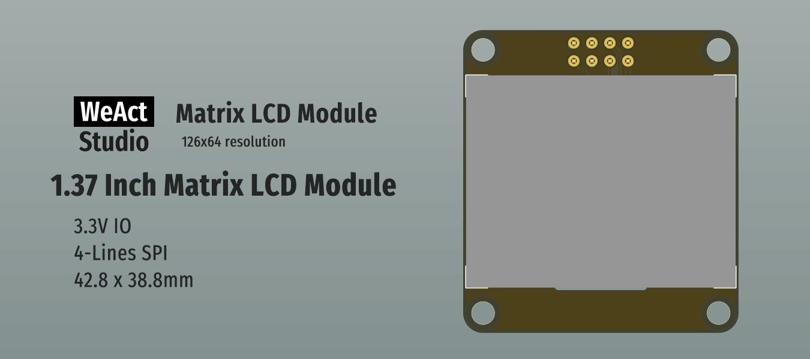

# WeActStudio.MatrixLCDModule

1.37 Inch Matrix LCD Module
1. Size: 42.8mm x 38.8mm
2. Interface: 4-Lines SPI
3. Driver chip: AiP31567(Same as ST7567)
4. Resolution: 128x64
5. Connector: mx1.25mm 1x8P / 2x4P 2.54mm

|Dir Name|Explain|
| :--:|:--:|
|Doc|DataSheet/ReferenceManual|
|Hardware|Hardware Development Kit|
|Examples|Software Examples|

```
/*---------------------------------------
- WeAct Studio Official Link
- taobao: weactstudio.taobao.com
- aliexpress: weactstudio.aliexpress.com
- github: github.com/WeActStudio
- gitee: gitee.com/WeActStudio
- blog: blog.weactstudio.com
---------------------------------------*/
```